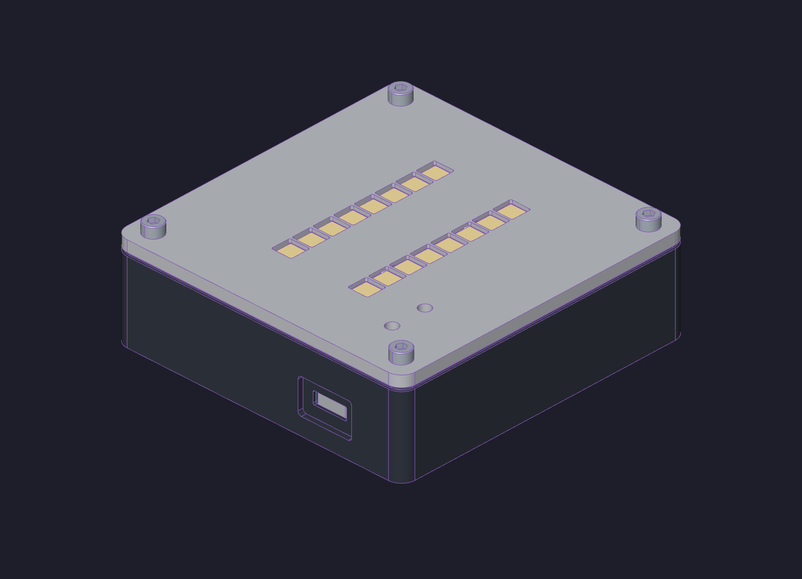
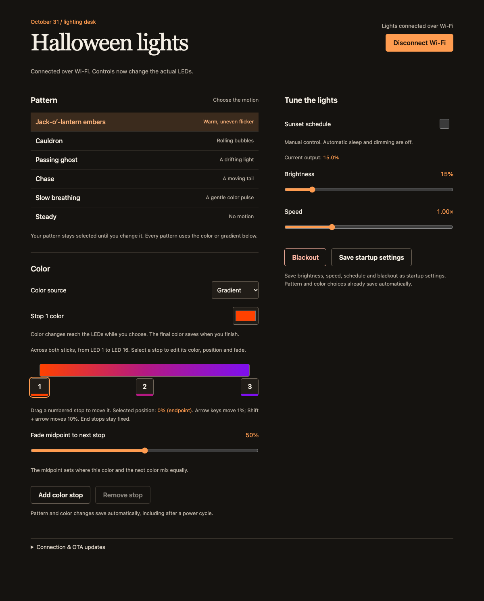

<div align="center">
<h1>Halloween LEDs</h1>
<p><strong>A battery-powered tabletop uplight with a browser control desk and an editable, four-part enclosure.</strong></p>
<p>
  <a href="STATUS.md"></a>
  <a href="firmware/"></a>
  <a href="mechanical/cad/"></a>
  <a href="mechanical/exports/stl/"></a>
</p>
<p><a href="https://github.com/ChrisNourse/halloween-leds/releases">Releases</a> · <a href="STATUS.md">Status &amp; known limitations</a> · <a href="docs/Halloween-LEDs-Build-Guide.pdf">Build guide</a> · <a href="BOM.md">Parts list</a> · <a href="mechanical/exports/stl/">Print files</a> · <a href="#connect-to-your-wi-fi">Wi-Fi setup</a> · <a href="mechanical/cad/">Editable CAD</a></p>
<p></p>
<p><em>Sixteen RGB pixels · ESP32-S2 Feather · CircuitPython · PETG enclosure</em></p>
</div>

Choose a Halloween lighting pattern, build a color gradient, or let the light follow sunset and sunrise. The Feather runs the show itself and serves the controls directly to your phone or computer. Closing the browser does not stop the lights.

> **v0.9.0 — experimental build:** final CAD, four printable STLs and the illustrated guide are synchronized. The print meshes pass digital checks. Hardware qualification is in progress: the reported boost wiring correction, fit, temperature and battery testing still need recorded results. See [project status](STATUS.md).

**Explore:** [Browser controls](#control-it-from-your-browser) · [Build one](#build-one) · [Wi-Fi setup](#connect-to-your-wi-fi) · [Connection help](#will-halloweenlocal-work-automatically) · [CAD design](#designed-to-be-understood-and-modified) · [Development](#project-layout-and-development)

## Control it from your browser



*The actual browser interface, captured with a simulated board connection for documentation.*

| Control | What it does |
| --- | --- |
| **Pattern** | Choose jack-o’-lantern embers, cauldron, passing ghost, chase, slow breathing or steady light. |
| **Color** | Use a single color or a gradient with two to six editable stops. Drag stops with a mouse or touch; adjust the fade between colors. |
| **Brightness & speed** | Set the output level and animation speed independently of the palette. |
| **Sunset schedule** | Start at sunset, dim through the evening, and sleep after sunrise. Set your location before installation. |
| **Blackout** | Turn the LEDs off while keeping controls available while the board is awake. |
| **Save startup settings** | Keep brightness, speed, schedule and blackout across resets. Pattern and color changes save automatically. |

The website connects automatically when opened from the Feather. There is no phone app to install or computer server to leave running. See [software operation](docs/software.md) for gradient editing, scheduling and updates.

## Build one

The build uses an **Adafruit ESP32-S2 Feather**, **two 8-pixel RGB NeoPixel sticks**, a **2000 mAh LiPo**, a **5 V boost module**, and **four printed PETG parts**. Screws and dowels can come from ordinary stainless assortment packs.

| Start here | What you’ll find |
| --- | --- |
| [Illustrated build guide](docs/Halloween-LEDs-Build-Guide.pdf) | Exploded assembly steps, hardware quantities, printing, wiring and first-power checks |
| [Bill of materials](BOM.md) | Quantities, sizes and purchase links |
| [Printable parts](mechanical/exports/stl/) | Four individual STLs, oriented for printing |
| [Wiring](docs/wiring.md) | Power/data diagram, board pin references, detachable LED harness and boost-voltage check |
| [SolidCraft models](mechanical/cad/) | Editable parts, assembly and shared hardware sources |

Measure the boost output at **5 V before connecting the LED sticks**. The installed module arrived in 12 V mode and required desoldering two voltage-selection resistors to change it to 5 V. See the [converter preparation notes](BOM.md#boost-converter-required-modification) and build guide before wiring it to the LEDs.

The top plate uses a **detachable JST LED connection** for servicing. Electrical documentation is still being completed: connector selection, harness pinout, wire sizes and routing photos are marked [TBD in the wiring guide](docs/wiring.md#electrical-details-to-complete). Follow-up releases will fill in those details as the design is tested.

## Connect to your Wi-Fi

Wi-Fi credentials are supplied during the first USB installation. The light joins your existing **2.4 GHz home network**; it does not provide a Wi-Fi setup hotspot or browser-based network setup screen.

### 1. Prepare the Feather

Install [CircuitPython for the Adafruit ESP32-S2 Feather](https://circuitpython.org/board/adafruit_feather_esp32s2/) and connect it with a USB-C **data** cable. Follow the board’s installation instructions until the `CIRCUITPY` drive appears. Install [uv](https://docs.astral.sh/uv/getting-started/installation/) on your computer for the project’s installer.

### 2. Add your network details

Copy [settings.example.toml](settings.example.toml) to a private location outside the repository, name it `settings.toml`, and fill in:

```toml
CIRCUITPY_WIFI_SSID="YOUR_2_4_GHZ_WIFI"
CIRCUITPY_WIFI_PASSWORD="YOUR_WIFI_PASSWORD"
CIRCUITPY_WEB_API_PASSWORD="YOUR_UNIQUE_DEVICE_UPDATE_PASSWORD"
CIRCUITPY_WEB_API_PORT=8080
CIRCUITPY_WEB_INSTANCE_NAME="Halloween LEDs"
LATITUDE="37.7749"
LONGITUDE="-122.4194"
TIMEZONE="America/Los_Angeles"
```

Keep the quotes and use your actual network name and password. The update password is separate from your Wi-Fi password. Keep populated settings out of Git.

The example defaults to **San Francisco**. For another location, change all three settings. For the sunset schedule, fill in `LATITUDE` and `LONGITUDE` in your private `settings.toml` using quoted decimal degrees (north/east positive; south/west negative). Set `TIMEZONE` to your IANA timezone, such as `America/New_York` or `Europe/London`. Blank or invalid coordinates keep manual lighting available and prevent automatic sleep; the browser prompts you to configure the location. `TIMEZONE` defaults to `America/Los_Angeles` and controls display only, including daylight saving time. Omitting both coordinate keys also defaults to San Francisco; providing only one coordinate requires completing the pair. Install the settings and restart after changes. No firmware edits are needed.

### 3. Install and restart

From the repository root, replace the example settings path with your private file:

```sh
uv run scripts/device.py inspect
uv run scripts/device.py install --settings /private/path/settings.toml
```

The default drive location is `/Volumes/CIRCUITPY` on macOS. On another system, pass `--volume` with your `CIRCUITPY` drive path. The installer checks the board, copies the firmware and website, and verifies the uploaded files. Tap **RESET** or disconnect/reconnect USB afterward.

For an already-installed board whose drive is hidden, use the [USB recovery/install instructions](docs/software.md#open-the-control-desk) before reinstalling. To change networks later, update your private settings and repeat the USB installation with `--settings`.

### 4. Open the website

Connect your phone or computer to the same home network, allow the Feather a few moments to join, then open:

**[http://halloween.local](http://halloween.local)**

Type the full `http://` address into the browser’s address bar. The board serves the website on port **80**, and the controls connect automatically. A phone on the router’s 5 GHz band can still work when both bands share the same local network.

**If the light is asleep during the day, press BOOT to wake it first.** Daytime deep sleep turns off Wi-Fi and both web services. A USB connection to a computer keeps it awake during setup; a USB wall charger does not. Disable **Sunset schedule** and save settings if you want manual access throughout the day.

## Will `halloween.local` work automatically?

**It should on a typical home LAN with mDNS support, but it is not guaranteed on every network or device.** The firmware announces `halloween` using CircuitPython’s [multicast DNS service](https://docs.circuitpython.org/en/stable/shared-bindings/mdns/). You normally do not need to configure router DNS or reserve an IP address.

Both devices need to share a local network that permits discovery and device-to-device traffic. Guest/client isolation, separate VLANs, blocked multicast or a VPN can interfere. Multicast discovery normally stays on the local subnet; see [Apple’s Bonjour networking explanation](https://developer.apple.com/library/archive/documentation/Cocoa/Conceptual/NetServices/Articles/NetServicesArchitecture.html).

| Symptom | Try this |
| --- | --- |
| `halloween.local` cannot be found | Use the Feather’s current IP address: `http://BOARD_IP`. Find it in your router’s connected-device list. |
| You need another way to find the IP | Connect the [USB browser controls](#optional-usb-controls), expand **Connection & OTA updates**, and read the board’s OTA address. Remove `:8080` to reach the lighting controls. |
| Neither the hostname nor IP works | Wake with BOOT, check Wi-Fi credentials and confirm both devices are on the same reachable LAN. Direct IP bypasses name discovery, but cannot bypass client isolation. |
| The browser tries HTTPS | Enter `http://` explicitly. This board serves HTTP. |
| It worked last night but not this morning | The sunset schedule may have put the board into daytime sleep. Press BOOT. |
| You are building several lights | All currently request the name `halloween`. Use each board’s IP address or assign distinct firmware hostnames; one shared name is not a reliable selector for multiple lights. |

A DHCP reservation in your router is optional if you want a stable IP fallback. Changing `CIRCUITPY_WEB_INSTANCE_NAME` changes the workflow display name, **not** the `halloween` hostname set by the application.

### Controls and updates use different ports

| Address | Purpose |
| --- | --- |
| `http://halloween.local` or `http://BOARD_IP` | Lighting controls; the site most people will use |
| `http://BOARD_IP:8080` | CircuitPython web workflow / application updates; requires the device update password |

Use the IP-based OTA address shown by the control desk, or the [OTA tool](docs/software.md#ota-application-updates). The lighting controls have no login; keep the device on a trusted LAN. Port forwarding is not needed.

## Optional USB controls

On a computer with Chrome or Edge, connect the Feather with a USB data cable, then run:

```sh
python3 -m http.server 8000 --bind 127.0.0.1 --directory web
```

Open **http://localhost:8000**, choose **Connect USB**, and select the Feather’s **data** serial interface, usually the second port. Close any other terminal using that port. This local server is only needed for USB control; Wi-Fi control is hosted entirely by the Feather.

## Designed to be understood and modified

The enclosure uses **named, dimensioned sketches and an organized sequence of native SolidCraft operations**. The layouts express where boards, fasteners and mating features belong, so a mechanical engineer can follow the design and change it. That same structure gives a human and an LLM a shared model to work on together.

Open [enclosure.solidcraft](mechanical/cad/enclosure.solidcraft) with its sibling part files and `hardware/` folder intact. Edit a source part, save it, update its assembly link, and regenerate affected print files. See [mechanical design](mechanical/README.md).

## Project layout and development

| Path | Contents |
| --- | --- |
| [firmware/](firmware/) | CircuitPython animation, scheduling and local web server |
| [web/](web/) | Browser control desk |
| [scripts/](scripts/) | USB installer and verified OTA updater |
| [mechanical/](mechanical/) | Native CAD and printable parts |
| [docs/](docs/) | Build guide, wiring and setup |
| [tests/](tests/) | Host and browser checks |

```sh
npm ci
npm test
npx playwright install chromium
npm run test:browser
```

The test suites cover firmware behavior, installation/OTA, browser controls, location settings, polar-season fallback and HTTP host validation. Physical assembly, thermal performance, battery runtime and sunrise/sunset transitions need their own hardware checks; see [project status](STATUS.md).

## Release and license

The project name is **halloween-leds**; the first release is **v0.9.0**, experimental while hardware qualification is in progress. Version **v1.0.0** is reserved for the qualified build. See [project status and known limitations](STATUS.md). Version tags prepare a GitHub release draft with generated change notes, the status at that tag, and downloadable project files; see [the release process](docs/releasing.md).

Original software uses **GPL-3.0-only**, hardware designs use **CERN-OHL-S-2.0**, and original documentation uses **CC BY-SA 4.0**. Commercial reuse is allowed subject to the source-sharing and attribution requirements of the applicable license. See [license scope and full texts](LICENSE.md) and [third-party notices](THIRD_PARTY_NOTICES.md).

Build-guide presentation inspired by [CURV LAB's WR1 Chassis Build Guide](https://www.curvlab.com/guides/wr1-build).
