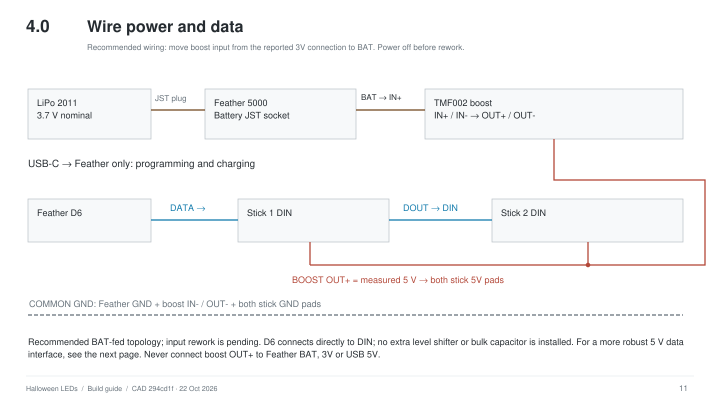
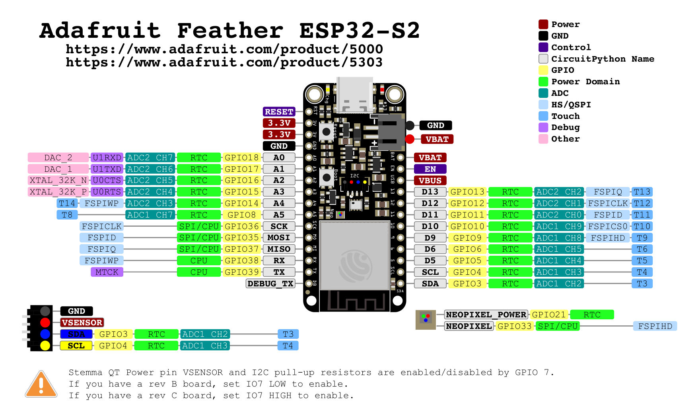

# Wiring and first power

This is the recommended BAT-fed wiring. The builder reports the current boost input is on **3V**, so the move to **BAT** is a pending hardware correction, not an already-verified change. The detachable LED harness is still being documented; the diagram does not specify connector cavities or wire colors. Board outlines are functional blocks, not physical pin positions. Read the actual silkscreen when soldering. Disconnect USB and the battery before wiring.

| From | To | Purpose |
| --- | --- | --- |
| Battery JST plug | Feather battery socket | Battery power and charging connection |
| Feather BAT | Boost IN+ | Unregulated battery voltage to boost |
| Feather GND | Boost IN- | Common return |
| Boost OUT+ | Both LED stick 5V pads | Measured regulated 5 V |
| Boost OUT- | Both LED stick GND pads and common GND | Common return |
| Feather D6 | First stick DIN | Data input (direct connection in the recorded build) |
| First stick DOUT | Second stick DIN | Pixels 9–16 follow pixels 1–8 |
| USB-C cable | Feather USB-C | Board programming and battery charging |

## Board pin references

*Pinout artwork by [Adafruit](https://learn.adafruit.com/adafruit-esp32-s2-feather/pinouts), [CC BY-SA 3.0](../LICENSES/CC-BY-SA-3.0.txt). Full page rendered to PNG; labels unchanged. See [third-party notices](../THIRD_PARTY_NOTICES.md).*

### ESP32-S2 Feather · Adafruit 5000

| Board label / interface | Connection in this project |
| --- | --- |
| `BAT` | Boost `IN+`, battery voltage |
| `GND` | Boost `IN-` and common ground |
| `D6` / `6` | LED data to first stick `DIN`; firmware uses `board.D6` |
| Battery JST socket | LiPo battery plug; verify polarity |
| USB-C | Programming and charging |
| `3V` / `3.3V` | Not used for LED or boost power |
| `USB` / `VBUS` | Not connected to boost output |

This is the project's connection subset. Use [Adafruit's full Feather pinout](https://learn.adafruit.com/adafruit-esp32-s2-feather/pinouts) and [physical pin-location PDF](https://github.com/adafruit/Adafruit-Feather-ESP32-S2-PCB/blob/main/Adafruit%20Feather%20ESP32-S2%20Pinout.pdf) to locate pads on the board. Match silkscreen rather than counting microcontroller package pins.

### RGB NeoPixel sticks · Adafruit 1426

[View Adafruit's NeoPixel Stick 1426 product page and rear-view photographs](https://www.adafruit.com/product/1426).

In the linked **back/solder-side** view, with the printed label upright, `DOUT` is on the left and `DIN` on the right. Each end reads **GND, data, 5VDC, GND** from top to bottom. Verify the actual silkscreen before soldering.

| Pad | Stick 1 | Stick 2 |
| --- | --- | --- |
| `DIN` | Data from Feather D6 | Data from stick 1 DOUT |
| `DOUT` | To stick 2 DIN | Leave unconnected |
| `5VDC` | Regulated boost output | Same regulated supply |
| `GND` | Common ground | Common ground |

The two sticks receive power in parallel; their data is chained in order. Turning a stick around in the enclosure does not change which pad is DIN.

## Removable top plate

The builder uses a **JST connector in the LED wiring** so the top plate can be removed without dismantling the base electronics. The connector family, contact count, wire order and which conductors pass through it are **to be confirmed**. The LED assembly needs 5 V, ground and data, but this does not establish the harness's cavity assignments.

Before unplugging the top plate, disconnect USB and battery power, support the plate, then separate the connector by its housings without pulling the wires. Leave enough service slack to reach the connector and route the harness clear of screws and mating surfaces. Final connector access and routing photos will be added after the design is finished.

### Electrical details to complete

| Item | Current record | Placeholder for the finished design |
| --- | --- | --- |
| Detachable LED connector | JST connector installed | Family, pitch, contact count, mating part numbers and purchase link |
| Harness pinout | Not yet recorded | Numbered mating-face drawing with latch orientation; cavity-to-signal table for both halves |
| Wire specification | Not yet recorded | Gauge, insulation, colors, cut lengths and stripped lengths |
| Harness routing | Top plate must unplug separately | Open-case photo, service loop, strain relief and solder-joint insulation |
| Boost preparation | TMF002: two resistors removed for 5 V | Annotated board photo and resistor reference designators |
| Replacement boost | TPS61023 candidate, untested | Exact board, measured voltage/current, fit and temperature results |
| Signal conditioning | Direct D6 connection in recorded build | Confirm final resistor, capacitor and level-shifter choices and locations |
| Electrical qualification | Pending | Load current, output voltage, enclosed temperature, cutoff behavior and runtime at stated brightness |

**TBD means not yet specified, not a suggested wiring choice.** Fill these entries from the finished build before treating the harness as reproducible. Connector housing shape and wire color alone do not establish polarity.

## Power and first-power checks

**Pending correction:** with USB and battery disconnected, move boost IN+ from Feather 3V to BAT. Keep IN- on GND. BAT is tied to the battery connector; no battery-lead splice is needed. The 3.3 V regulator is rated at 500 mA peak and also supplies the controller, making it unsuitable for this boosted LED load. Verify boost output with the LED supply disconnected before reconnecting the sticks. Measure load current and temperature after the correction.

Keep all grounds common. Never use the Feather 3V regulator for the boost input. Do not connect boosted 5 V to BAT, 3V or USB 5V. The boost is not a charger. See [Feather power management](https://learn.adafruit.com/adafruit-esp32-s2-feather/power-management).

The installed TMF002 arrived in **12 V mode**. The builder **desoldered two voltage-selection resistors to put it in 5 V mode**. Disconnect both USB and battery before this modification. The recorded seller instructions describe both A and B selections open for 5 V, but the exact resistor positions and reference designators are not documented here: identify them using instructions for your actual board revision before removing anything.

Keep the LED supply disconnected while powering and measuring the converter output. Confirm approximately **5 V**, then remove power before connecting the sticks. Recheck output under load. Continuous output capability and battery cutoff behavior have not been measured for this installation. See the [BOM converter notes](../BOM.md#boost-converter-required-modification) for the untested TPS61023 candidate and the checks needed before substitution.

For more reliable signaling, add a 74AHCT125 between D6 and the first DIN, a 300–500 Ω series data resistor near DIN, and a 500–1000 µF capacitor across pixel 5 V/GND. Use at least a 6.3 V capacitor rating and observe polarity. These follow [Adafruit's NeoPixel guidance](https://learn.adafruit.com/adafruit-neopixel-uberguide/best-practices). The additional components are not included in the enclosure fit check.

For the standard 14-pin 74AHCT125 channel 1: pin 14 to regulated 5 V, pin 7 to GND, pin 1 (/OE) to GND, pin 2 to D6, and pin 3 through the resistor to DIN. Add 0.1 µF at VCC/GND. Disable unused channels and tie their inputs to defined logic levels. Verify your exact package against the [TI datasheet](https://www.ti.com/lit/ds/symlink/sn74ahct125.pdf).

Use the [build guide](Halloween-LEDs-Build-Guide.pdf) for assembly order and the first lighting check. Start at low brightness, test all three primary colors and all sixteen pixels, and check for heating before closing the enclosure.
