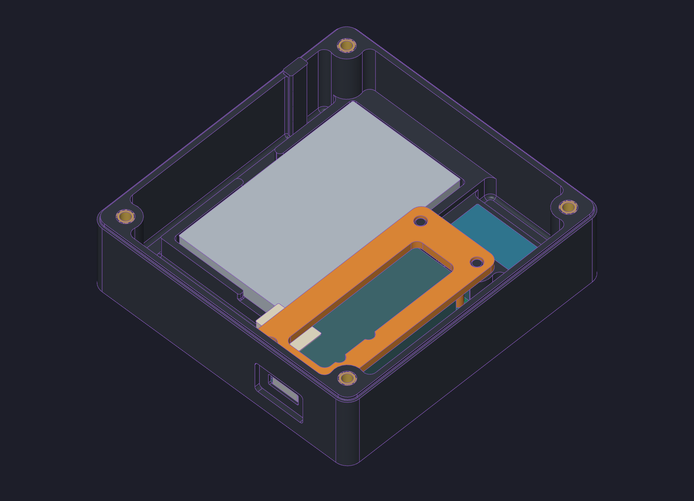

# Mechanical design

The native CAD and four print meshes are synchronized to the completed mechanical handoff (`294cd1f`). The latest changes include the 0.86 mm USB-C wall and compatible R0.5 XY corners. Each STL is a watertight single solid, oriented with its bed face at Z=0. Physical fit and thermal testing remain pending.

Open [cad/enclosure.solidcraft](cad/enclosure.solidcraft) with all sibling files and `hardware/` intact. The assembly uses relative links.

| File | Purpose |
| --- | --- |
| `base.solidcraft` | Case, electronics supports, USB recess and lid key |
| `faceplate.solidcraft` | LED apertures, retaining bosses and lift stops |
| `led-retainer.solidcraft` | LED PCB supports and alignment collars |
| `feather-retainer.solidcraft` | Removable controller retaining frame |
| `hardware/` | Shared screw, insert and dowel sources |

Edit named sketches, driving dimensions and feature operations in a part, save it, then update that link in the assembly and save. Coordinate mating dimensions across source documents; link refresh does not synchronize parameter tables. Regenerate affected STL derivatives after geometry changes.

Print PETG with a 0.4 mm nozzle, 0.20 mm layers, four perimeters and supports off, using a tested material profile. Base underside down; faceplate exterior down; LED frame broad side down with rails up; Feather frame broad top down with sleeves up.

See the [build guide](../docs/Halloween-LEDs-Build-Guide.pdf) for insert preparation, part orientations, assembly steps and checks. Electronics are simplified reference envelopes. The drawings omit flexible wiring and solder detail. Do not print hardware or electronic references.

The body is nominally 88 × 86 × 27.2 mm, excluding 3 mm screw heads. The models fit a 180 × 180 mm print bed. Actual connector, wire, screw and pouch clearances still need a physical assembly trial.

## Assembly views

[Full exploded assembly](previews/exploded.png): four printed parts, five electronic modules, twelve screws, twelve inserts and two dowels. Reference electronics are simplified envelopes; wiring is not modeled.

## Validation

[Print mesh checks](validation/print-meshes.json) record the exported hashes, bounds and mesh results. The final native handoff reported no feature errors and zero-DOF sketches in the three changed parts; the base retains an existing geometry-reference warning on its floor-root fillet. [Handoff summary](validation/mechanical-handoff.json). No new slicing or physical trial was performed during packaging.
